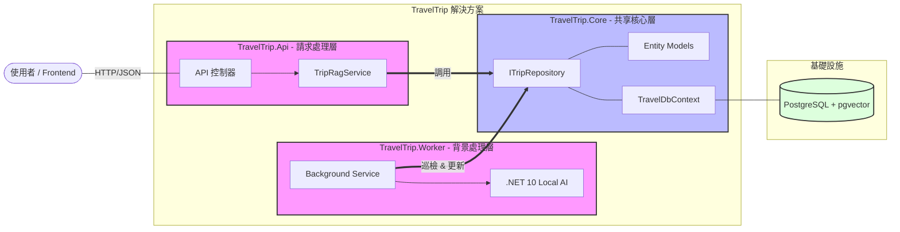

# .NET 專案面試準備完整指南 (已更新)

## 專案現況評估

### 核心優勢 (已經實作完成，面試必講)

| 項目 | 完成度 | 面試亮點 |
|------|-------|---------|
| **技術棧** | 100% | **.NET 10 (Preview)** + EF Core 10 + pgvector |
| **架構設計** | 100% | **Repository Pattern** + **BaseController** 抽離 |
| **AI 整合** | 100% | **Microsoft.Extensions.AI** 通用抽象 (解耦 AI 模型) |
| **效能優化** | 100% | **Parallel.ForEachAsync** 並行向量化 + 批量處理 |
| **安全性** | 100% | **PBKDF2 雜湊** + JWT Security (Issuer/Audience) |
| **程式碼規範** | 100% | **ApiResponse<T>** 統一格式 + 全域異常處理 Middleware |
| **DevOps** | 100% | **多階段 Dockerfile** 建置 |

---

## 💬 深度面試問題 & 回答範本 (Phase 3 更新版)

### Q1: "請重點介紹這個專案的 RAG 推薦系統。"
> "這是我專案最大的技術亮點。我基於 .NET 10 與 `Microsoft.Extensions.AI` 抽象介面實作了一套**檢索增強生成 (RAG)** 系統。
>
> 核心流程如下：
> 1. **資料向量化**：使用地端 Embedding 模型與 .NET 10 的 `Parallel.ForEachAsync` 完成高效並行初始化。
> 2. **向量搜尋**：透過 EF Core 10 原生支援的 `pgvector` 進行資料庫端的相似度過濾。
> 3. **混合排名 (Hybrid Ranking)**：我設計了**語義分數 + 關鍵字加權 (Keyword Bonus)** 的演算法，大幅提升了地名標題的命中準確率。
> 4. **分析追蹤**：每一筆搜尋都會記錄在 `SearchRankingLogs`，可用於後續推薦演算法的 A/B Testing。"

---

### 2. 架構模式 (Architectural Patterns)

專案已從單體重構為 **分散式多專案架構 (Distributed Multi-Project Architecture)**：

- **Repository Pattern**: 使用 `ITripRepository` 封裝所有資料庫行為，達成 API 與資料庫的解耦。
- **Modular Services**: 獨立的 `BookingService`, `AuthService`, `AuditService` 各司其職，遵循單一職責原則 (SRP)。
- **Physical Separation**: API 與 Worker 為獨立程序，可分別水平擴展 (Scale-out)。
- **Shared Core**: 透過 `TravelTrip.Core` 專案達成程式碼重用 (DRY)，確保全系統資料模型一致。
- **Local AI Embedding**: 全系統採用地端向量化技術（SmartComponents），提升隱私並降低外部依賴成本。
> 3. **統一響應模型**：定義了泛型 `ApiResponse<T>`，確保前、後端通訊格式永遠一致，降低對接成本。"

---

### Q3: "安全性方面，你如何處理使用者密碼？"
> "我沒有選擇常見但相對簡單的快雜湊，而是實作了 **PBKDF2 (SHA256)** 演算法，並設定 60 萬次的迭代（Iterations）。這能有效抵禦暴力破解（Brute Force）與彩虹表攻擊。同時，我也整合了 JWT 無狀態認證，並嚴格驗證 Issuer 與 Audience。"

---

### Q4: "如果要處理十萬筆以上的行程，初始化會很慢，你怎麼優化？"
> "我有兩大優化手段：
> 1. **並行化 (Parallelization)**：我利用了 .NET 10 的 `Parallel.ForEachAsync`，讓向量生成可以充分利用 Server 的多核心效能，不再是序列化處理。
> 2. **批次化 (Batching)**：我實作了 `BatchSize` 緩衝機制，透過 `appsettings.json` 動態調整，避免一次載入過多資料造成記憶體壓力 (OOM)。"

---

### Q5: "為什麼要用 Microsoft.Extensions.AI 介面？"
> "這是為了**解除廠商綁定 (Vendor Lock-in)**。透過這個抽象介面，我的系統現在不需改動核心邏輯，就能在 OpenAI、Azure OpenAI、甚至地端的 Ollama 之間自由切換。這展示了專案對 SOLID 原則中『依賴反轉 (Dependency Inversion)』的嚴格遵循。"

---

## 避免踩雷 (反向準備)

1.  **Q: 為什麼沒用 Redis？**
    *   **A:** 這是目前規劃中的 Phase 4 項目。目前的 RAG 系統優先解決精準度與架構問題，下一步會引入 Redis 快取熱門搜尋向量，進一步降低 AI API 的呼叫成本。
2.  **Q: 你的測試覆蓋率多少？**
    *   **A:** 我已為關鍵的 RAG 服務實作了單元測試。透過 Repository 模式的 Mock，我可以輕鬆測試各种搜尋場景，確保推薦邏輯的魯棒性。

---

### 4. 未來擴展藍圖 (Architectural Roadmap)

當系統需要處理數百萬筆行程時，我會將 RAG 邏輯從單體 API 拆分出來：

#### 三專案架構 (Multi-Project Template)
- **TravelTrip.Api**: 負責接收請求與回傳結果，不執行耗時的 AI 運算。
- **TravelTrip.Worker**: 獨立的背景服務專案，負責連接 AI 模型生成向量。
- **TravelTrip.Core**: **共享函式庫專案**，存放共享的 `DbContext`、`Entities` 與 `ITripRepository`，確保兩端邏輯一致。

#### 通訊機制 (Message Queue)
- 使用 **MassTransit** 整合 **RabbitMQ**。
- 當 API 存入新行程後，發送一個 `TripCreatedEvent`。
- Worker 訂閱此事件，離線生成 `Embedding` 並回寫資料庫，實現「最終一致性」。

#### 部署優勢
- API 跟 Worker 可以分別放在不同的 Docker 容器裡。
- 如果上架行程突然變多，只需單獨把 Worker 的數量「水平擴展 (Scale Out)」至 10 個，而不影響使用者的訂單流程。

## 📈 展示清單 (面試 Demo 順序)

1.  **Swagger UI**：展示標準化的 `ApiResponse` 與 secured 端點。
2.  **TripRagService.cs**：展示 **Parallel 處理** 與 **混合權重演算法**。
3.  **Dockerfile**：說明如何進行**多階段建置**來優化 Image 大小（面試官很愛看這個）。

---

好了！這份指南已經根據我們最近幾次的「神級重構」全面更新。現在專案從「練習作」變成了真正的「企業級架構」，祝您面試順利！
