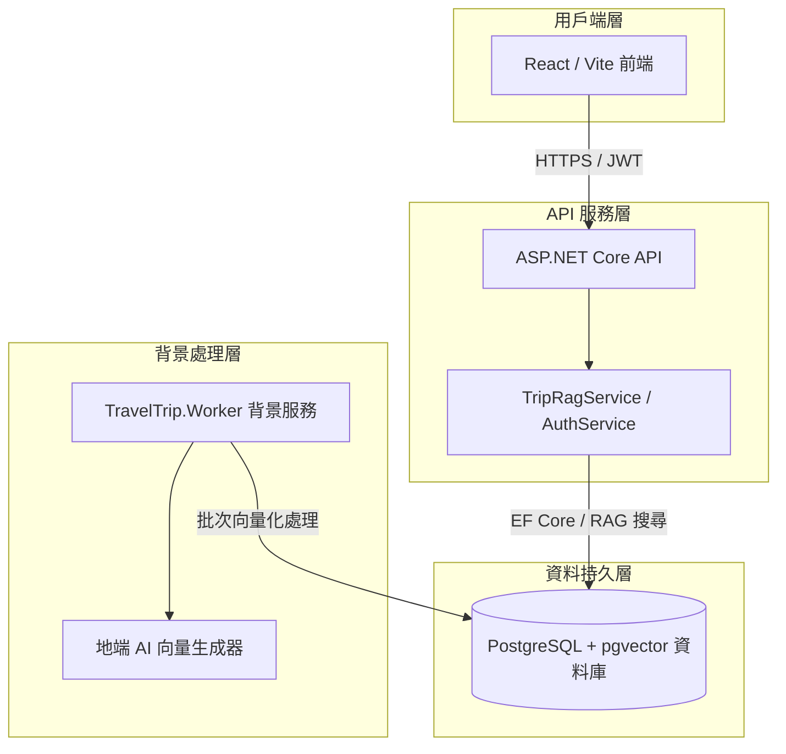
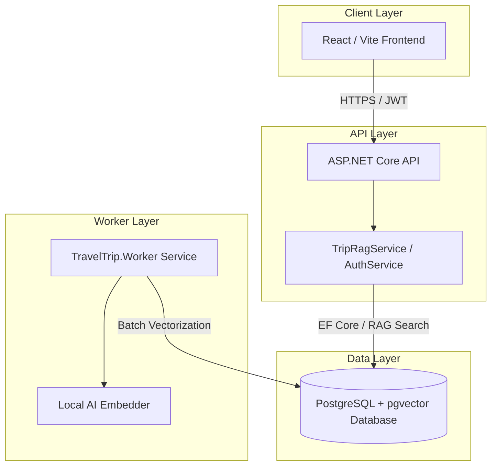

# TravelTrip: Native RAG Travel Assistant

[繁體中文](#繁體中文) | [English](#english)

---

## 繁體中文

### 專案簡介
**TravelTrip** 是一個基於 **.NET 10** 開發的高性能旅遊行程搜尋與推荐系統。本專案的核心競爭力在於採用 **原生 RAG (Retrieval-Augmented Generation)** 技術，透過 **pgvector** 與 **地端 Embedding 模型** 實作深度語義搜尋，達成資料隱私與零成本 AI 整合。

### 技術亮點
- **.NET 10 原生 AI 整合**: 運用 `Microsoft.Extensions.AI` 抽象介面，實現與 AI 模型供應商的解耦，並使用本地模型生成向量。
- **混合搜尋演算法 (Hybrid Search)**: 自定義 `TripRagService` 結合向量相似度與關鍵字權重，顯著提升旅遊景點的匹配精準度。
- **分散式微服務架構**: 
  - **Api 服務**: 負責即時請求與 RAG 檢索。
  - **Worker 服務**: 背景非同步向量化，確保系統高可用。
- **高性能並行優化**: 使用 `Parallel.ForEachAsync` 充分發揮多核 CPU 效能，加速大規模資料初始化。
- **現代化設計模式**: 嚴格遵循 **SOLID 原則**、**Repository Pattern** 與 **Clean Architecture** 思維。

### 系統架構
本專案採用效能導向的分散式架構。您可以查閱下方的 Mermaid 架構圖，或下載 [Draw.io 原始繪圖檔 (中文版)](./docs/diagrams/arch-simple-cn.drawio)。

---

## English

### Introduction
**TravelTrip** is a high-performance travel search and recommendation engine built on **.NET 10**. It features a native **RAG (Retrieval-Augmented Generation)** implementation using **pgvector** and **local embedding models**, providing deep semantic search without external API dependencies.

### Key Technical Features
- **Native .NET 10 AI Abstractions**: Uses `Microsoft.Extensions.AI` to ensure vendor neutrality and modular AI integration.
- **Hybrid Search Algorithm**: Combines semantic vector search with keyword-based scoring for superior destination discovery.
- **Distributed Microservices Architecture**: Decouples real-time API requests from heavy background vectorization tasks via a standalone Worker service.
- **Concurrency & Scaling**: Leverages `Parallel.ForEachAsync` for high-throughput data processing.
- **Enterprise Design Patterns**: Implements **Repository Pattern**, **Unit of Work** (via EF Core), and **Clean Architecture** principles.

### Architecture
The project follows a distributed architecture designed for performance. Below is the Mermaid visualization. You can also download the [Source Draw.io File (English)](./docs/diagrams/arch-simple-en.drawio).

---

### Tech Stack
- **Framework**: .NET 10 (ASP.NET Core / Background Worker)
- **Database**: PostgreSQL + pgvector
- **AI**: Microsoft SmartComponents (Local Embedder)
- **Frontend**: React (Vite)
- **Security**: JWT, PBKDF2 Password Hashing
