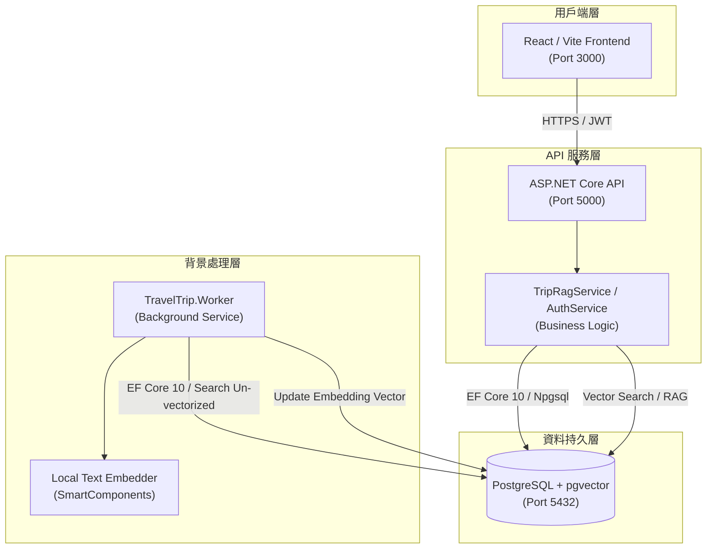
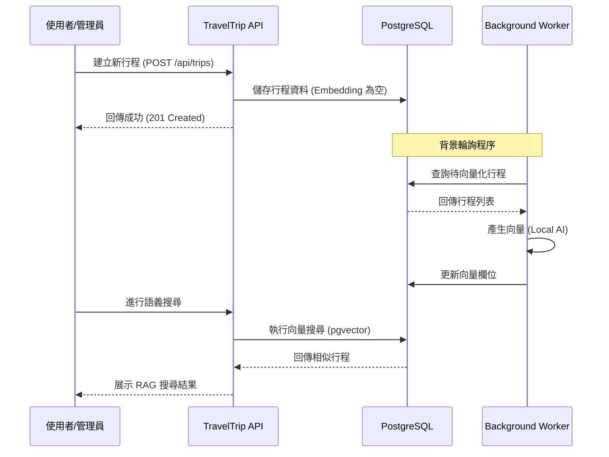

# TravelTrip 系統架構圖 (Architecture Diagram)

本專案採用分散式架構，將耗時的 AI 向量化處理移至背景服務，確保 API 的高可用性與回應速度。

## 系統架構概覽

## 核心組件說明

### 1. Frontend (React / Vite)
- 提供使用者介面，透過 JWT 與 API 進行驗證。
- 呼叫 `/api/trips/search` 進行 AI 智慧搜尋。

### 2. TravelTripApi (.NET 10)
- **職責**：處理 CRUD、身份驗證、以及即時搜尋請求。
- **RAG 實作**：使用 `TripRagService` 調用 `pgvector` 進行語義搜尋。
- **效能優化**：不直接負責向量生成，避免阻塞 HTTP 請求。

### 3. TravelTrip.Worker (Background Service)
- **職責**：非同步處理 AI 向量化。
- **流程**：
    1. 每 30 秒掃描資料庫中尚未向量化的行程（`Embedding == null`）。
    2. 使用 `LocalTextEmbedder`（SmartComponents）生成向量。
    3. 更新資料庫中的向量欄位。

### 4. PostgreSQL + pgvector
- **儲存**：所有的行程資料與使用者資訊。
- **向量搜尋**：支援原生 `<->` (L2 Distance) 或 `<#>` (Inner Product) 運算符，實作高效的 RAG 查詢。

## 關鍵流程：非同步向量化 (RAG Flow)

