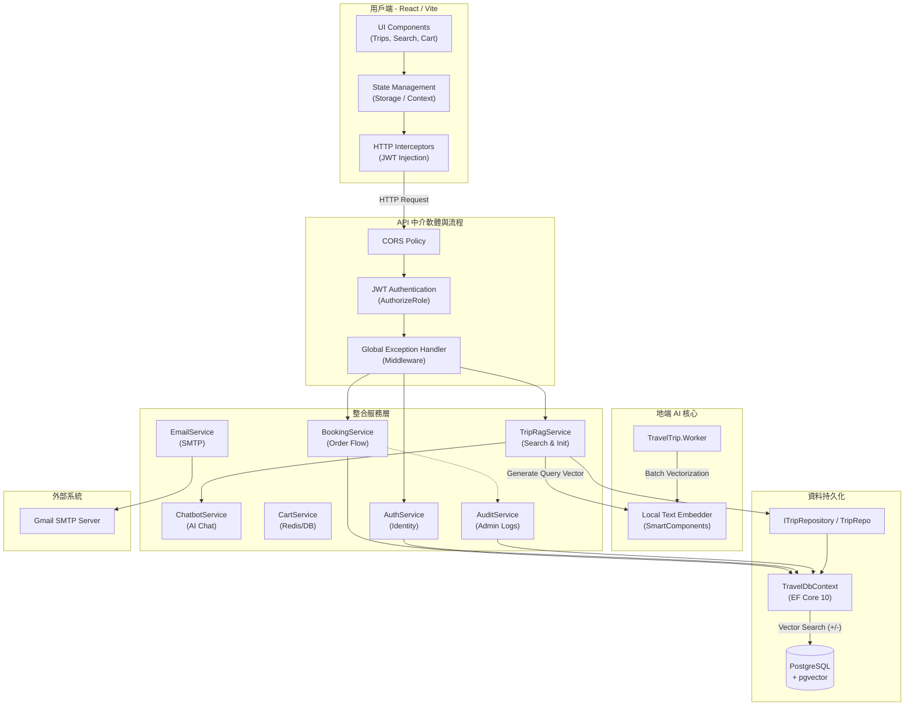

# TravelTrip 詳細內部架構 (Detailed Architecture)

本文件提供 TravelTrip 系統更深層次的技術細節，包含中介軟體、完整服務鏈以及地端 AI 的整合方式。

## 1. 完整系統流程圖 ( granular level )

## 2. 核心組件詳細職責

### A. 基礎設施與中介軟體 (Infrastructure & Middleware)
- **Global Exception Handler**: 捕捉所有未處理異常，並回傳統一格式的 `ApiResponse<T>`，包含詳細的錯誤訊息與 HTTP 狀態碼。
- **JWT Authorization**: 在 Controller 層級透過 `AuthorizeRole` 屬性進行細粒度的權限控制（如：Admin, User）。
- **PostgreSQL + pgvector**: 利用 `vector` 資料類型儲存 384 維度的地端向量，並透過 EF Core 10 的 `o.UseVector()` 進行搜尋。

### B. AI 推薦流程 (RAG Flow)
1. **地端向量化**: 系統**完全不依賴外部 OpenAI API**。使用 Microsoft SmartComponents 在地端執行小型高效的 Embedding 模型。
2. **多重排名演算法**:
   - **語義搜尋**: 計算餘弦相似度或 L2 距離。
   - **關鍵字加權**: 針對地名、國家進行記憶體內二次加權（Bonus Score），解決純向量搜尋可能遺漏精確關鍵字的問題。

### C. 業務邏輯服務
- **BookingService**: 處理複雜的原子操作，包含行程存在性校驗、座位數（庫存）扣減、訂單建立，並確保所有步驟在一個資料庫事務（Transaction）內完成。
- **AuditService**: 記錄管理員的所有變更操作（Old Value vs New Value），並自動記錄操作者的 IP 位址與 User-Agent。
- **ChatbotService**: 整合 RAG 搜尋結果與模擬對話邏輯，提供使用者智慧導購體驗。

## 3. 分散式 Worker 邏輯
- **TravelTrip.Worker** 是一個獨立進程，它與 API 共享 `TravelTrip.Core` 層的模型與數據庫上下文。
- 它採用**非同步補償機制**：即使 API 在寫入行程時 AI 服務斷線，Worker 也會在下次輪詢時自動修復漏掉的向量，保證「最終一致性」。
